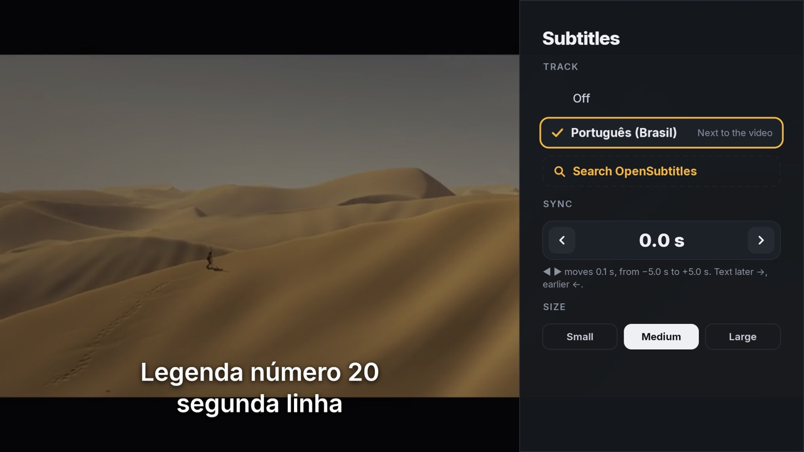
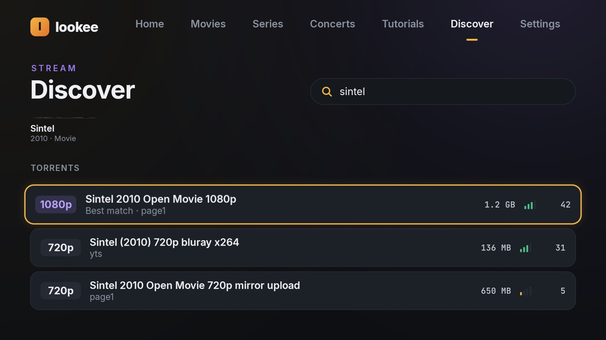
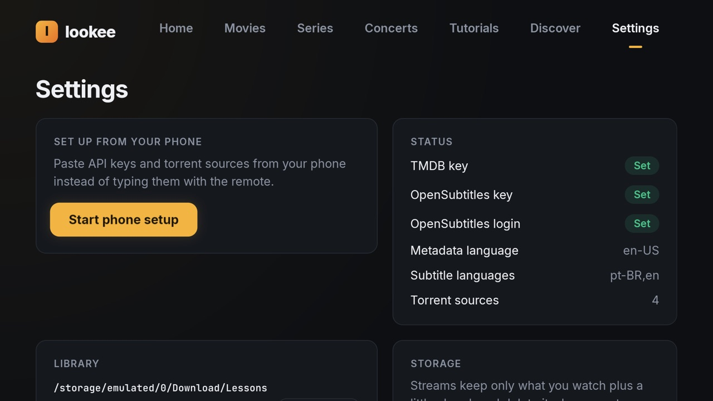

# lookee

A lightweight media center for Android TV, built for the Xiaomi Mi Box.

I wanted one app on my TV that plays the movies, series and concerts on my USB drive with proper posters and synopses, opens my guitar lesson folders without trying to "match" them to anything, finds subtitles while the film is already playing, and can stream something I don't have yet. Nothing I tried did all of that well on a box with 2 GB of RAM, so I'm building it.

> **Status:** in daily use on a Mi Box: library, disc rips with menus, torrent streaming and online subtitles all work. See the [roadmap](docs/ROADMAP.md) for what's done and what's next.

| Subtitles mid-playback | Discover search | Settings from your phone |
|---|---|---|
|  |  |  |

## What it does

- **Local library** — scans a USB drive, parses release filenames, and pulls titles, artwork and cast from TMDB. DVD and Blu-ray rips play with their menus.
- **Plain folder playback** — browse and play tutorials and personal videos exactly as they sit on disk.
- **Subtitles on demand** — search OpenSubtitles mid-playback, load the result without leaving the player, and nudge the timing.
- **Torrent streaming** — search, pick a quality and start watching while it downloads, with the cache cleaned up afterwards.
- **Remote-first** — every screen works with a D-pad.

## How it's built

lookee is two pieces:

| Piece | Language | Job |
|---|---|---|
| `core/` | Go | Scanning, filename parsing, TMDB, SQLite, subtitles, torrent streaming over a local HTTP server |
| `app/` | Kotlin | Jetpack Compose for TV interface; playback with Media3 (ExoPlayer) and libVLC for discs |

The Go core is compiled to an Android library with `gomobile bind` and talks to Kotlin through a small JSON API. Kotlin holds no business logic. Because the core is plain Go, all of it can be run and tested on a laptop through `lookee-cli` before it ever touches a TV. [ARCHITECTURE.md](docs/ARCHITECTURE.md) has the diagram.

## Installing

Download the APK from the [latest release](https://github.com/lucasbittar/lookee/releases/latest): `armeabi-v7a` for the Mi Box and most TV boxes, `arm64-v8a` for 64-bit ones. Then either:

- **Without a computer:** install the free *Downloader* app on the TV, open the release page in it and install the APK. Allow it to install unknown apps when Android asks.
- **With a computer:** turn on USB debugging on the TV (Settings → Device preferences → About → press Build seven times, then Developer options), then

  ```bash
  adb connect <TV_IP>:5555
  adb install -r lookee-<version>-armeabi-v7a.apk
  ```

Updates install over the previous version and keep your library, settings and progress.

## Building

Requirements: Go 1.26+, JDK 17, Android SDK + NDK r28 and `gomobile`. Setup steps are in [Phase 0 of the roadmap](docs/ROADMAP.md#phase-0--toolchain--repo-scaffolding); `make doctor` checks them. From a clean clone, one command runs the whole pipeline (Go tests and lint, the Android library, Android lint, Kotlin tests, the debug APK):

```bash
make all
```

The pieces:

```bash
make test      # Go unit tests
make lint      # go vet + golangci-lint
make bind      # Go core → app/libs/lookeecore.aar (with x86 for the emulator)
make apk       # debug APK
make install MIBOX_IP=192.168.1.50
make release   # signed release APKs: see docs/RELEASING.md
```

## Try the core on your computer

Everything except playback runs on a laptop through `lookee-cli`:

```bash
make cli
core/lookee-cli settings set tmdb_api_key <your key>
core/lookee-cli scan ~/Movies --category MOVIES
core/lookee-cli list
core/lookee-cli show 1
core/lookee-cli fix 1 "the right title"   # Fix Match
core/lookee-cli browse ~/Videos/Guitar    # Tutorials browser
```

Add `--json` to see exactly what the TV app receives.

## API keys and sources

lookee ships with no keys and no torrent sources. Everything is added from your phone: **Settings → Start phone setup** shows a QR code and a PIN; the page it opens takes your keys and source addresses, saves them on the TV only, and never shows them back.

1. **TMDB** (posters, synopses, cast; required): create a free account at [themoviedb.org](https://www.themoviedb.org/signup), then Settings → [API](https://www.themoviedb.org/settings/api) → request a key (personal use). Paste the *API Key* or the *Read Access Token*.
2. **OpenSubtitles** (subtitle search; optional): create a free account at [opensubtitles.com](https://www.opensubtitles.com), then [Consumers](https://www.opensubtitles.com/consumers) → new consumer → copy its API key. Adding your username and password too raises the daily download limit.
3. **Torrent sources** (Discover; optional): see [SOURCES.md](docs/SOURCES.md).

## Documentation

- [Roadmap](docs/ROADMAP.md) — phases, exit criteria, decisions and risks
- [Architecture](docs/ARCHITECTURE.md) and the [Go ↔ Kotlin bridge](docs/BRIDGE.md)
- [Design](docs/DESIGN.md) — the visual language
- [Torrent sources](docs/SOURCES.md) and [Releasing](docs/RELEASING.md)
- [CLAUDE.md](CLAUDE.md) — full specification and coding conventions

## Legal

lookee is a media player. It does not host, bundle or index any content. Torrent search uses third-party sources configured by the user, and you are responsible for making sure what you stream is legal where you live.

This product uses the TMDB API but is not endorsed or certified by TMDB.

## License

[MIT](LICENSE)

lookee plays discs and some audio formats with [libVLC](https://www.videolan.org/vlc/libvlc.html) (LGPL-2.1-or-later), linked dynamically from VideoLAN's `libvlc-all` Android library. The fonts (Inter, Bebas Neue, JetBrains Mono) are under the SIL Open Font License; see `app/licenses/`.
