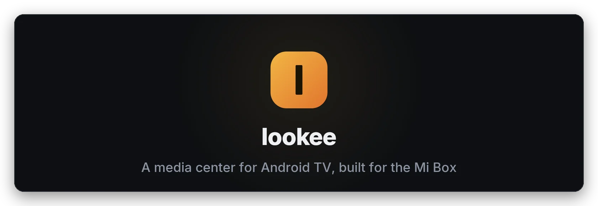
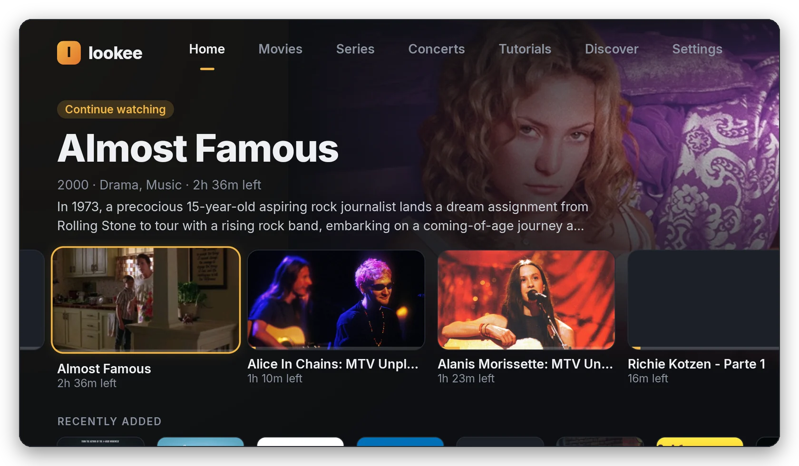
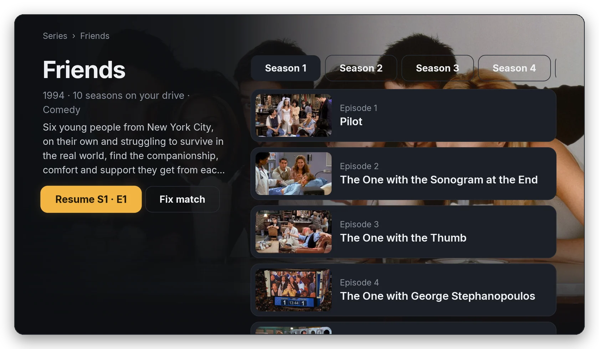
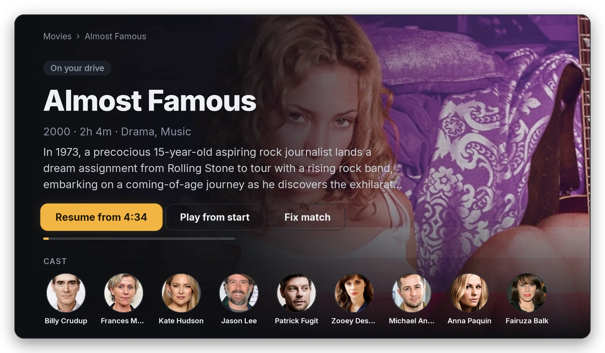
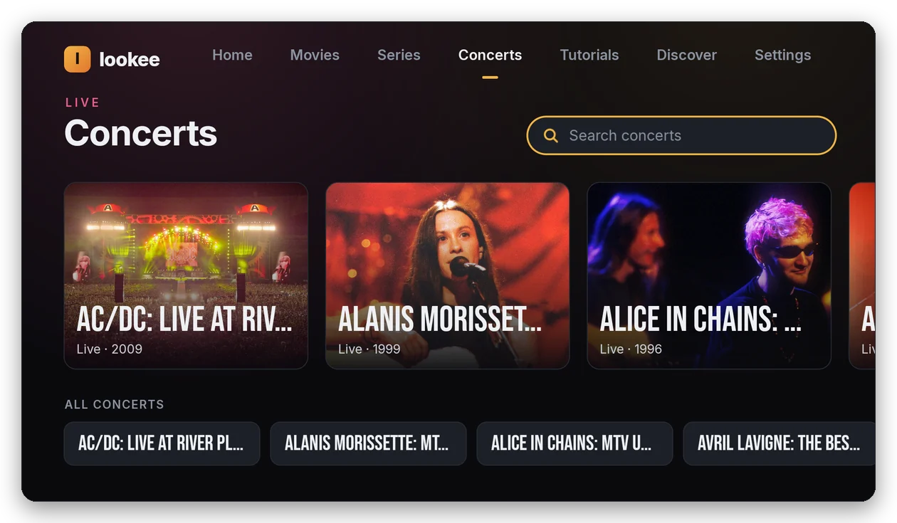
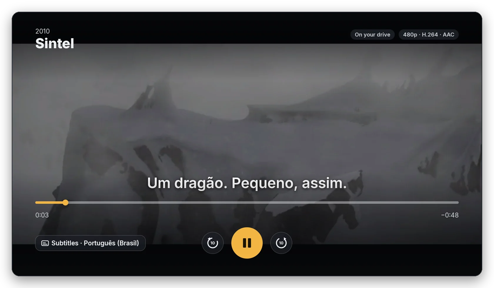
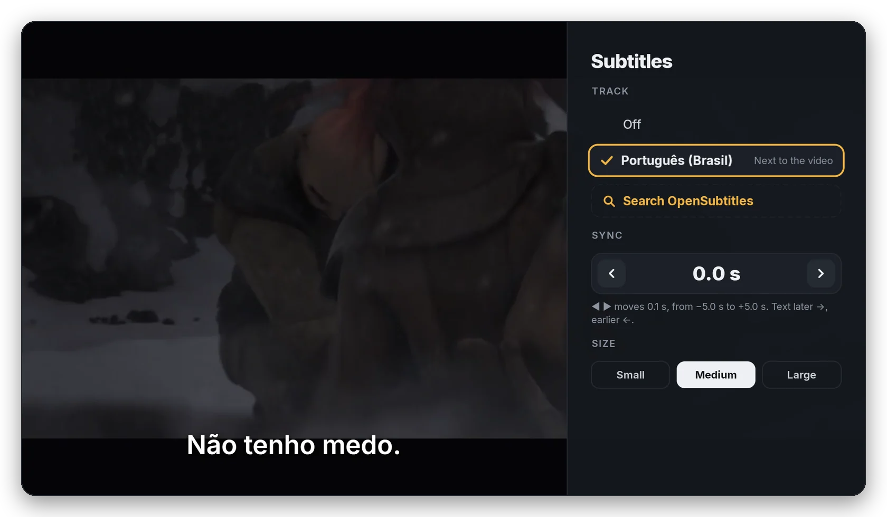
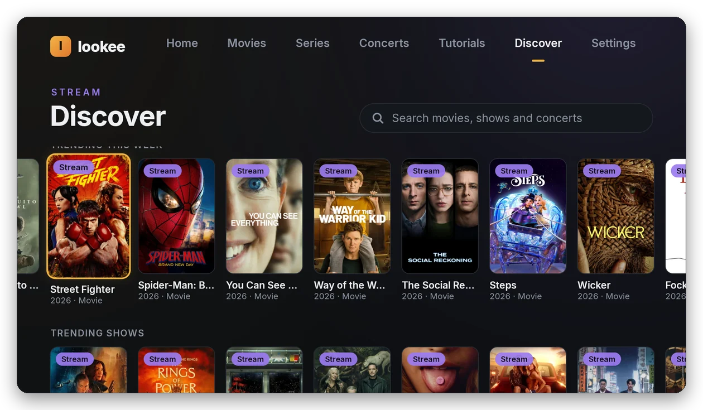
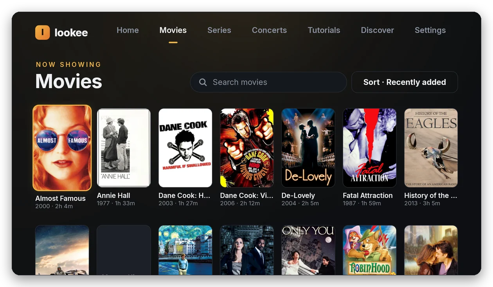
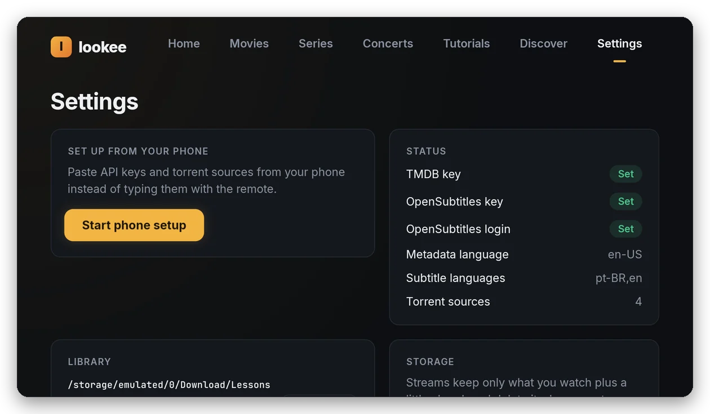

<p align="center">
  
</p>

<p align="center">
  <a href="https://github.com/lucasbittar/lookee/actions/workflows/ci.yml"></a>
  <a href="https://github.com/lucasbittar/lookee/releases/latest"></a>
  
  
  
  <a href="LICENSE"></a>
</p>

<p align="center">
  <a href="#install"><b>Install</b></a> ·
  <a href="#a-tour"><b>Tour</b></a> ·
  <a href="#set-it-up"><b>Set it up</b></a> ·
  <a href="#build-it"><b>Build it</b></a> ·
  <a href="docs/ARCHITECTURE.md"><b>Architecture</b></a>
</p>

<br>

One app for everything on the TV: the movies, series and concerts on a USB drive with proper posters and synopses; guitar lessons and home videos played straight from their folders; DVD and Blu-ray rips with their menus; subtitles found while the film is already playing; and anything you don't have yet, streamed. All of it on a Xiaomi Mi Box with 2 GB of RAM, driven by the remote.

I built it because I left Kodi over its interface and nothing else covered all of this well on a small box.

<br>

<p align="center">
  
</p>

## A tour

### Pick up where you left off

Home leads with what you were watching. Each Continue Watching card shows the frame where you stopped, and the banner behind it changes with focus: the backdrop, the synopsis, how long is left. What you just watched moves to the front.

### Series that know where you are

<p align="center">
  
</p>

Every show on the drive gets its backdrop, its seasons and each episode's still and title. Resume takes you to the next episode, and the ones after it queue up, so the next one starts on its own.

### Every film gets its page

<p align="center">
  
</p>

Titles, years, runtimes, genres, synopses and the cast's photos come from TMDB, matched from messy release filenames. When a match is wrong, **Fix match** sets it right from the remote.

### Concerts get the stage

<p align="center">
  
</p>

Live shows have their own room: wide stage cards, the year they were played, and DVD and Blu-ray rips that open at their menus, just as the disc would. The TV switches to the video's frame rate, so PAL concerts play without a stutter.

### A player that stays out of the way

<p align="center">
  
</p>

Four seconds after you stop pressing buttons, it's just the picture. ◀ ▶ skip ten seconds, OK pauses, and the chips at the top say what you're watching. Files play in ExoPlayer on the box's hardware decoders; discs and formats ExoPlayer can't handle hand over to libVLC at the same spot.

<p align="center">
  
</p>

Subtitles next to the video come on by themselves in your language. Missing one? **Search OpenSubtitles** from the panel and pick a result: it's on screen a moment later, without restarting the film. Off by a beat? **Sync** moves it in tenth-of-a-second steps while you watch.

### Stream what you don't have

<p align="center">
  
</p>

Discover shows what's trending and searches everything TMDB knows. Pick a title, then a source by quality and seeders, and it starts playing while it downloads. When you stop, the downloaded pieces are deleted, so the box's storage stays free. lookee ships with no sources: you add your own.

### Your whole library, at a glance

<p align="center">
  
</p>

### Set up from your phone

<p align="center">
  
</p>

Nobody wants to type an API key with a remote. Settings shows a QR code and a PIN; your phone opens a page on the TV, you paste your keys and sources there, and they never leave the box.

<br>

## Install

Download the APK from the [latest release](https://github.com/lucasbittar/lookee/releases/latest): **`armeabi-v7a`** for the Mi Box and most TV boxes, `arm64-v8a` for 64-bit ones.

- **Without a computer:** install the free *Downloader* app on the TV, open the release page in it and install the APK. Allow it to install unknown apps when Android asks.
- **With a computer:** turn on USB debugging on the TV (Settings → Device preferences → About → press *Build* seven times, then Developer options), then

  ```bash
  adb connect <TV_IP>:5555
  adb install -r lookee-<version>-armeabi-v7a.apk
  ```

Updates install over the previous version and keep your library, settings and progress.

## Set it up

lookee ships with no keys and no torrent sources. Open **Settings → Start phone setup** and add them from your phone:

1. **TMDB** (posters, synopses, cast; required): create a free account at [themoviedb.org](https://www.themoviedb.org/signup), then Settings → [API](https://www.themoviedb.org/settings/api) → request a key for personal use. Paste the *API Key* or the *Read Access Token*.
2. **OpenSubtitles** (subtitle search; optional): create a free account at [opensubtitles.com](https://www.opensubtitles.com), then [Consumers](https://www.opensubtitles.com/consumers) → new consumer → copy its API key. Your username and password too raise the daily download limit.
3. **Torrent sources** (Discover; optional): see [SOURCES.md](docs/SOURCES.md).

Then add your drive's folders under **Library** and pick what each one holds: Movies, Series, Concerts or Tutorials.

## Build it

lookee is two pieces. A **Go core** does the heavy lifting: scanning the drive, parsing filenames, TMDB, SQLite, subtitles, disc rips and torrent streaming over a local HTTP server. A thin **Kotlin app** in Jetpack Compose for TV draws the screens and plays the video. The core compiles to an Android library with `gomobile bind` and speaks JSON to the app ([ARCHITECTURE.md](docs/ARCHITECTURE.md) has the diagram).

You'll need Go 1.26+, JDK 17, the Android SDK with NDK r28, and `gomobile`; `make doctor` checks them. From a clean clone, one command runs the whole pipeline: Go tests and lint, the Android library, Android lint, Kotlin tests and a debug APK.

```bash
make all
```

The pieces, one at a time:

```bash
make test      # Go unit tests
make lint      # go vet + golangci-lint
make bind      # Go core → app/libs/lookeecore.aar (with x86 for the emulator)
make apk       # debug APK
make install MIBOX_IP=192.168.1.50
make release   # signed release APKs (docs/RELEASING.md)
```

Everything but playback also runs on a laptop, through `lookee-cli`:

```bash
make cli
core/lookee-cli settings set tmdb_api_key <your key>
core/lookee-cli scan ~/Movies --category MOVIES
core/lookee-cli show 1
core/lookee-cli fix 1 "the right title"   # Fix Match
```

Add `--json` to see exactly what the TV app receives.

## Documentation

- [Roadmap](docs/ROADMAP.md): phases, exit criteria, decisions and risks
- [Architecture](docs/ARCHITECTURE.md) and the [Go ↔ Kotlin bridge](docs/BRIDGE.md)
- [Design](docs/DESIGN.md): the visual language
- [Torrent sources](docs/SOURCES.md) and [Releasing](docs/RELEASING.md)

## Legal

lookee is a media player. It doesn't host, bundle or index any content. Torrent search uses sources you configure, and you're responsible for making sure what you stream is legal where you live.

Screenshots show the app with its own artwork from [TMDB](https://www.themoviedb.org). This product uses the TMDB API but is not endorsed or certified by TMDB.

## License

[MIT](LICENSE). lookee plays discs and some audio formats with [libVLC](https://www.videolan.org/vlc/libvlc.html) (LGPL-2.1-or-later), linked dynamically from VideoLAN's `libvlc-all` Android library. The fonts (Inter, Bebas Neue, JetBrains Mono) are under the SIL Open Font License; see `app/licenses/`.
