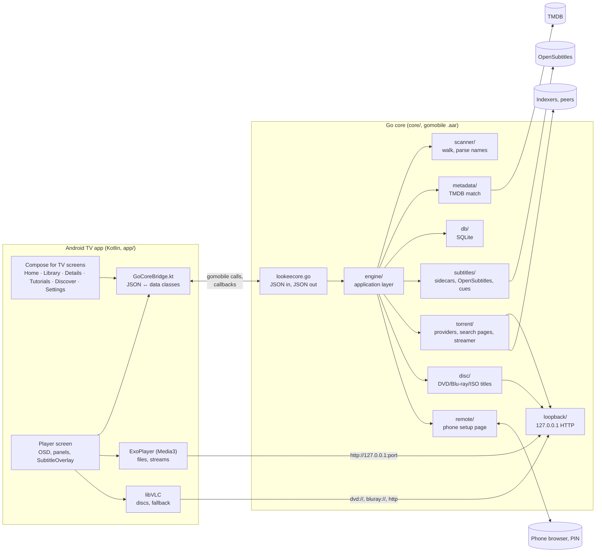

# Architecture

lookee is a Go core inside a thin Kotlin TV app. The core owns every rule and every byte of state; the app draws screens and plays video.

## The rules

- **Kotlin holds no business logic.** No HTTP clients, parsers or databases in `app/`: the app asks the core, renders what comes back, and plays the URL it is given.
- **JSON over the bridge.** gomobile only carries simple types, so every call takes strings and numbers and returns a JSON string (or an error that starts with a code). The full list is in [BRIDGE.md](BRIDGE.md).
- **Everything the core does runs on a laptop.** `core/cmd/lookee-cli` drives the same `engine` package, so scanning, matching, subtitles and streaming are tested on macOS before they reach the TV.
- **Diagnose without ADB.** The Mi Box's only USB port serves either the drive or ADB, so anything worth knowing on the device goes to the core's rolling log, readable from the phone page.

## How playback is wired

1. The screen asks the core what to play: a file path, a disc (`playDisc` serves the main title on `127.0.0.1`), or a torrent (`startStream` serves the picked file on `127.0.0.1` with HTTP range requests).
2. Files and streams start in **ExoPlayer**; discs open in **libVLC** at their menus, and ExoPlayer hands over to VLC at the same position if it can't play a file (ROADMAP Decision 14).
3. The TV's refresh rate follows the video's frame rate while the player is open.
4. Subtitles inside the file are the engine's; files next to the video and OpenSubtitles downloads are parsed by the core (`getSubtitleCues`) and drawn by `SubtitleOverlay`, so they load and re-sync instantly under either engine (Decision 17).
5. Progress is saved every few seconds and on exit; a frame grabbed from the video becomes the Continue Watching picture.

## State

| What | Where |
|---|---|
| Library, matches, progress, settings and keys | SQLite in the app's private files (`db/`) |
| Torrent pieces | A per-stream folder on the drive's app directory, deleted when the stream stops |
| Downloaded subtitles, preview frames | The app's cache directory |
| Log | A rolling file in the app's private files, shown on the phone page |

## Building and releasing

`make all` runs the whole pipeline from a clean clone; [RELEASING.md](RELEASING.md) covers signing and version tags. CI (`.github/workflows/`) runs the Go tests and lint, Android lint, the Kotlin tests and a debug build on every push, and publishes signed APKs for every `v*` tag.
